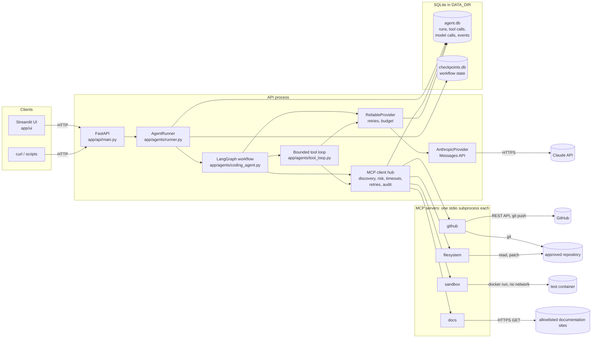
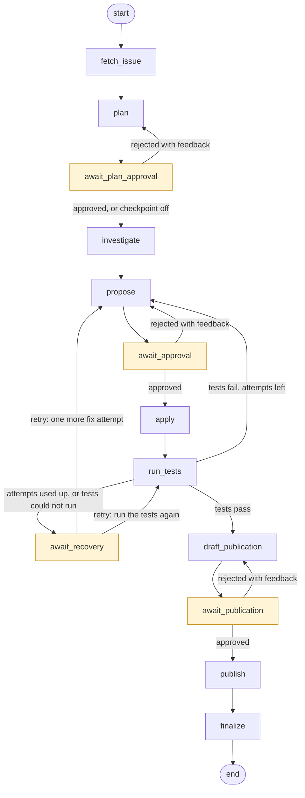
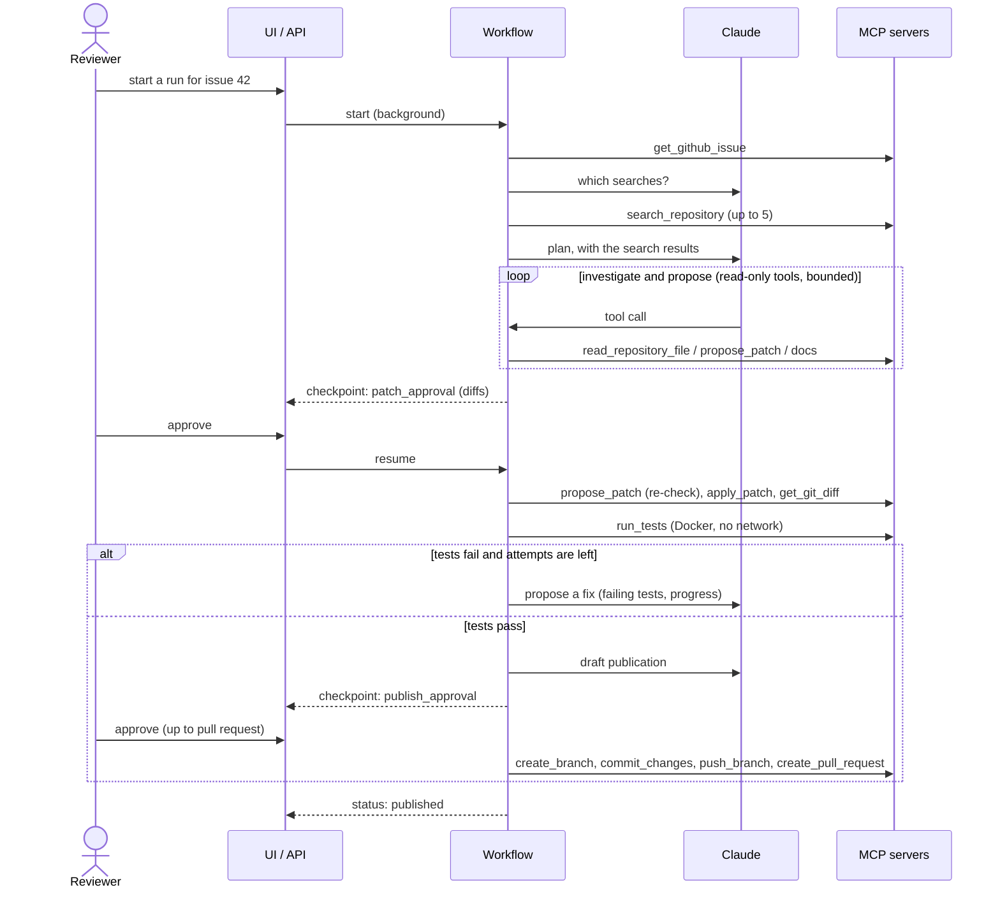

# Architecture

The agent works on one GitHub issue in one repository. Claude does the reasoning, everything that
touches the outside world goes through one of four MCP servers, and a LangGraph workflow decides
the order of the steps and where a person has to approve. Below is how the pieces fit together;
the [security model](SECURITY.md) explains why they're split up this way, and the
[design notes](DESIGN.md) explain the other choices.

## Components

| Component | Responsibility |
|---|---|
| Streamlit UI | Start runs, show the plan, diffs, test results, cost and failures; answer each checkpoint. A thin client of the API. |
| FastAPI | Starts runs and answers checkpoints in background tasks; serves run state, the audit trail and the discovered tools. See [API.md](API.md). |
| `AgentRunner` | Creates runs, invokes and resumes the graph with the SQLite checkpointer, retries failed runs from the failed step, enforces the run budget, records status and failures. |
| LangGraph workflow | The fixed order of steps and the human checkpoints. Graph guards, not prompts, make sure the issue is read before planning, the code is searched before patching, and nothing is written without approval. |
| Tool loop | Lets the model call read-only tools inside the `investigate` and `propose` steps. Checks every call against the tool's schema and the per-step and per-run limits, and logs refused calls. |
| `ReliableProvider` → `AnthropicProvider` | Model calls through the official `anthropic` SDK and the Messages API. Adds retries with exponential backoff and checks the budget before every attempt. The model comes from `ANTHROPIC_MODEL`. |
| MCP client hub | Starts the four servers, discovers their tools at start-up, classifies each tool's risk from its MCP annotations, enforces per-call timeouts, retries temporary errors of read-only tools, and writes every call to the audit log (redacted). |
| SQLite | `agent.db`: runs, tool calls, model-call metadata (never prompts), events and decisions. `checkpoints.db`: the workflow state after every step, so runs survive restarts and can be resumed or retried. |

## MCP servers

Each server is a separate process with a minimal environment. It gets only the settings and
credentials its own job needs.

| Server | Responsibility | Tools | Credentials | Reaches |
|---|---|---|---|---|
| `github` | Read issues; create the branch, commit, push and open the pull request after approval | `get_github_issue`, `create_branch`, `commit_changes`, `push_branch`, `create_pull_request` | `GITHUB_TOKEN` (the only server that gets it) | GitHub REST API and git remote, or local fixtures |
| `filesystem` | Search and read the approved repository; validate patches; apply approved patches; show the diff | `search_repository`, `read_repository_file`, `propose_patch`, `apply_patch`, `get_git_diff` | none | the repository at `REPO_PATH` only |
| `sandbox` | Run the allowlisted test command in Docker on a disposable copy of the repository | `run_tests` | none | the Docker daemon; the test container has no network |
| `docs` | Search and read allowlisted documentation (GET only, no JavaScript, no cookies) | `list_documentation_sources`, `search_documentation`, `read_documentation` | none | https sites in `config/docs_sources.json` |

The model is offered only tools that discovery classifies as read-only. The tools that change
something (`apply_patch` and the GitHub write tools) are called by the workflow, after a human
approves, with exactly the approved values.

## Workflow

Each box is a LangGraph node; the `await_*` nodes are human checkpoints (`interrupt`). When a
step fails, it goes straight to `finalize`, which records the failure; those edges are left out
here to keep the picture readable.

| Step | What happens | Tools |
|---|---|---|
| `fetch_issue` | Read the issue. | `get_github_issue` |
| `plan` | The model picks up to five code searches, the workflow runs them, and the model writes the plan from what they found: summary, steps, acceptance criteria, files to change. | `search_repository` |
| `await_plan_approval` | Optional (`REQUIRE_PLAN_APPROVAL`). | none |
| `investigate` | The model gets the search results from planning and reads code (and documentation) with read-only tools. | `search_repository`, `read_repository_file`, docs tools |
| `propose` | The model proposes patches; each is validated without writing. | `propose_patch`, read tools |
| `await_approval` | A human approves the exact patches, or rejects them with feedback. | none |
| `apply` | Every approved patch is checked against the current files, then applied; the diff is captured. | `propose_patch`, `apply_patch`, `get_git_diff` |
| `run_tests` | The configured test command runs in Docker; the output is analyzed (failing tests, failure kind). | `run_tests` |
| `await_recovery` | When the fix attempts run out or the tests cannot run: retry with guidance, or stop. | none |
| `draft_publication` | The model drafts the branch name, commit message and PR text, then a second call fact-checks that text against the issue, the diff and the test runs and corrects it. Changes and test results come from the record. | none |
| `await_publication` | A human chooses how far to publish (branch, push, pull request) and may edit the texts. | none |
| `publish` | Branch, commit, push, pull request: only the approved steps, with the approved values. | GitHub write tools |
| `finalize` | Record the outcome, the failure if any, and a summary. | none |

## One run, step by step

A complete recorded run, rendered from its audit log, is in
[examples/runs/](../examples/runs/).

## State and storage

| Data | Where | Used for |
|---|---|---|
| Workflow state (issue, plan, proposals, approvals, diffs, test runs, publication, timeline) | `DATA_DIR/checkpoints.db` (LangGraph) | Resuming at checkpoints, retrying failed runs, the run view |
| Runs (status, failure), tool calls, model calls, events | `DATA_DIR/agent.db` | Audit, run budget, evaluation (`scripts/evaluate.py`) |
| Documentation search indexes | `DATA_DIR/docs_cache/` | Fewer downloads; expires after `DOCS_CACHE_TTL_SECONDS` |
| Fixture-mode pull requests | `DATA_DIR/pull_requests/` | The sample flow without GitHub |

## Main design decisions

- **One MCP server per capability, one process each.** A server gets only its own credentials
  and settings, so the GitHub token never reaches the code that runs tests or reads web pages.
- **The model only reads.** Changes happen in workflow steps after approval, so a persuaded or
  confused model cannot write, commit or publish anything.
- **Checkpoints in the graph, not in prompts.** The order of steps and the approvals are code;
  the model cannot skip them.
- **Validate, then apply exactly what was approved.** Patches are validated when proposed,
  compared by SHA-256 against the approval, and checked again before any is written.
- **Everything recorded, nothing estimated.** Costs, latencies and outcomes come from the audit
  log, which is also what the evaluation reads.
